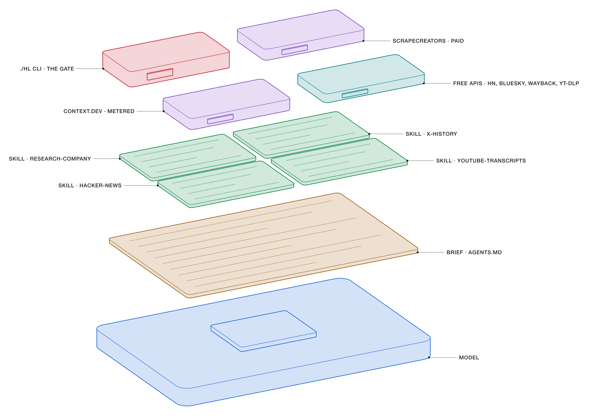
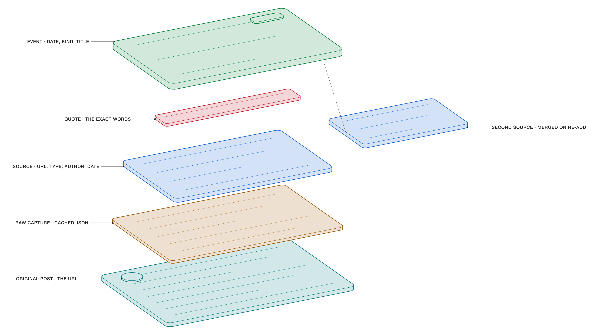
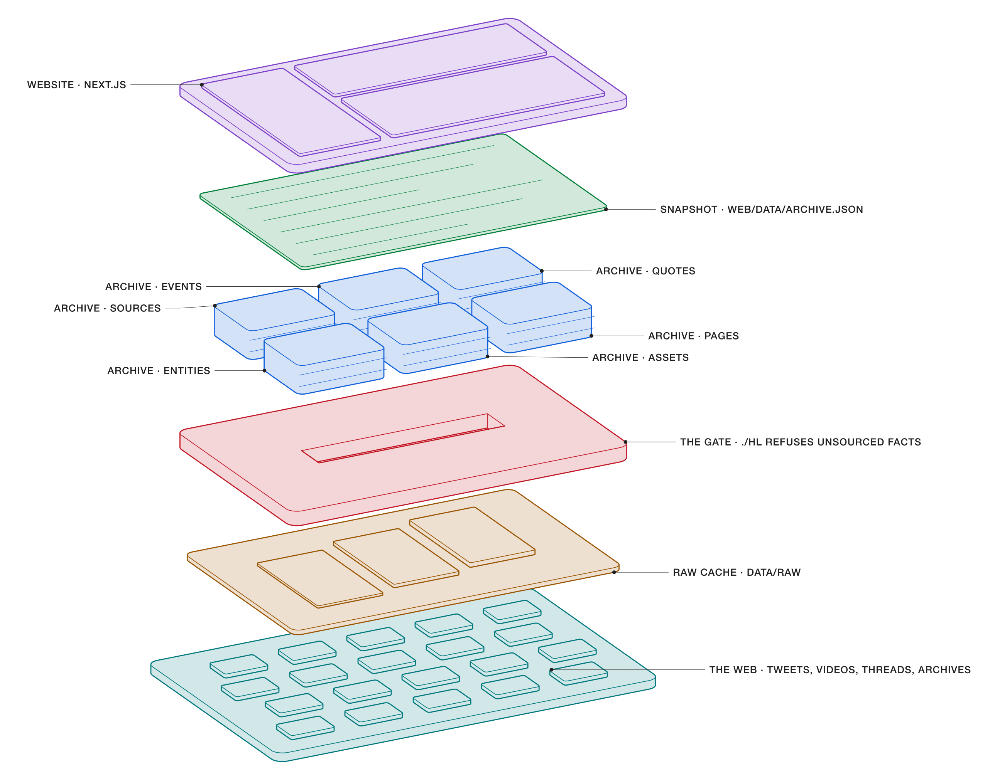
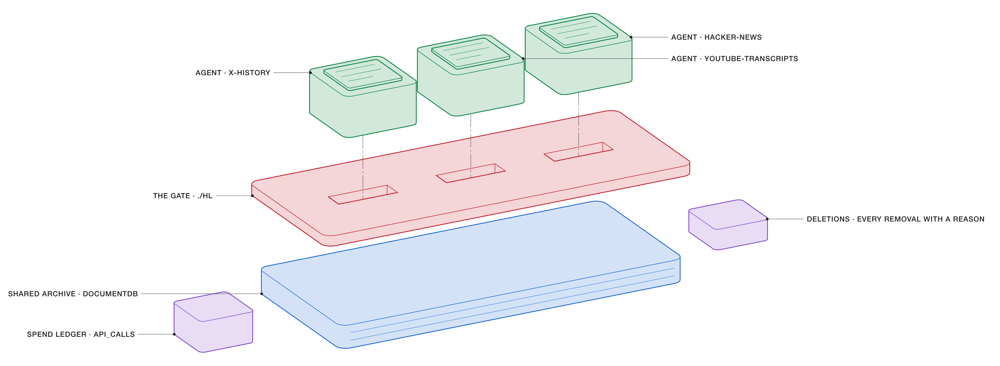

# Hyperlore

DeepWiki for startups: the sourced history of companies (renames, logos, funding rounds, launches, quotes), rebuilt by agents from primary sources. Every claim links to where it was said.

As of the last snapshot (3 Nov 2026), the archive holds 456 companies, 8,762 dated events, 2,533 verbatim quotes and 12,422 sources. Agents collected all of it, and an agent can’t write a fact without its source.

- [How the agents work](#how-the-agents-work)
  - [An agent is four layers](#an-agent-is-four-layers)
  - [No source, no fact](#no-source-no-fact)
  - [From the web to the website](#from-the-web-to-the-website)
  - [Many agents, one archive](#many-agents-one-archive)
  - [Judgment rules](#judgment-rules)
  - [Run one](#run-one)
- [Layout](#layout) · [Publishing](#publishing) · [Secrets](#secrets) · [About the figures](#about-the-figures)

## How the agents work

### An agent is four layers

<p align="center">
  
</p>

A research agent is a general model with three things stacked on top of it. From the bottom up:

1. **Model.** Claude, either in Claude Code or through the standalone [`./research`](#run-one) program on the Claude API. It knows nothing about Hyperlore until it reads the layers above.
2. **Brief.** [`AGENTS.md`](AGENTS.md) is the contract every agent reads first: the schema, the allowed event kinds, date precision, the quality bar and the rule that no source means no fact.
3. **Skills.** [`.claude/skills/`](.claude/skills) holds the method, one folder per job. `research-company` runs a whole company end to end and calls on the others:

   | Skill | What it’s for |
   | --- | --- |
   | `research-company` | The full method: identify, collect, record, judge, write, publish |
   | `hacker-news` | Launch threads and founders’ own HN comments (backstory, numbers) |
   | `x-history` | Years-old tweets with exact dates and text |
   | `youtube-transcripts` | Timestamped transcripts, so quotes link to `…&t=754s` |
   | `bluesky-history` | Full author feeds and handle changes for AT Protocol companies |
   | `wayback-history` | Dating renames, domain moves, taglines and pricing changes |
   | `logo-history` | Logos, wordmarks and icons over time, with light and dark variants |
   | `people-photos` | Attributed portraits, with checks against wrong-person matches |
   | `write-lore-page` | Overviews and cross-company stories, written from the archive only |
   | `publish-hyperlore` | Snapshot, build, push and verify production |

4. **Tools.** What reaches the web. Free sources go first, and paid calls are cached and counted:
   - `./hl`: the only way to read or write the archive (see below).
   - `./hl sc …`: [ScrapeCreators](https://docs.scrapecreators.com) for tweets, Google results, YouTube and LinkedIn. Credits cost money.
   - `./hl ctx …`: [Context.dev](https://docs.context.dev) for brand data, news and page scraping. It has a large balance, but every call is metered.
   - Free: the Hacker News Algolia API, the Bluesky AppView, the Wayback Machine CDX, the GitHub API and `yt-dlp` captions, with `whisper` as a last resort.

### No source, no fact

<p align="center">
  
</p>

Every fact in the archive is a short chain, and each link is a separate record:

- **Original post.** The tweet, video, HN comment, article or Wayback snapshot, by URL.
- **Raw capture.** The response as fetched, cached under `data/raw/` and pointed to by `raw_path`. A dead link doesn’t erase the evidence.
- **Source.** One record per URL: type, title, author, publication date and the excerpt that matters.
- **Quote.** The exact words on the event that support the claim. Video quotes carry a timestamp.
- **Event.** The fact itself: company, date (only as precise as the source: `2020`, `2020-04` or `2020-04-21`), kind, title, summary and confidence (`sourced`, or `inferred` with the reasoning given).

`./hl` enforces the order. Register the source first, or the event is refused:

```console
$ echo '{"company":"vercel","date":"2020-04-21","kind":"rename","title":"ZEIT renames to Vercel",
         "sources":[{"url":"https://x.com/rauchg/status/123","quote":"…"}]}' | ./hl event
{"ok": false, "error": "unknown source https://x.com/rauchg/status/123: add it with `hl source` first"}
```

When a second agent re-adds the same event (same company, kind, date and title), `./hl` doesn’t create a duplicate. It merges the new source into the existing event, so the event gains corroboration. If two sources disagree, both stay on the event and the summary says so.

### From the web to the website

<p align="center">
  
</p>

1. **The web.** Founders’ tweets, interviews, HN threads, blogs, press and archived homepages.
2. **Raw cache.** Every ScrapeCreators and Context.dev response is saved in `data/raw/` and served from there next time, so the same question is never paid for twice.
3. **The gate.** `./hl` checks the URL, type, date format and event kind, and refuses any event, quote or page whose sources aren’t registered.
4. **The archive.** A DocumentDB with six collections: `sources`, `events`, `quotes`, `entities` (people, investors, places, former names), `assets` (logos, screenshots) and `pages` (cited prose, written with `{{cite:<url>}}` markers).
5. **The snapshot.** `./hl export` writes the whole archive to `web/data/archive.json` and copies logos and photos into `web/public`.
6. **The website.** The [Next.js site](web/) reads the live database in local development and the snapshot in production. It builds company pages, people, investors, rounds, ⌘K search and an open API from it.

### Many agents, one archive

<p align="center">
  
</p>

Many agents often run at once, on different companies or on different sources for the same company. Five things keep that safe:

- **One gate.** Every agent writes through the same `./hl`, so the same rules hold whoever is writing.
- **Merging, not overwriting.** Re-adding an event merges sources. Entity writes union their aliases, roles and sources, and append to the summary.
- **A spend ledger.** Each agent sets `export HL_AGENT=<name>`. Every paid call is logged in `api_calls` with the agent’s name, and `./hl stats` shows spend per agent.
- **A deletions log.** Wrong records are removed with `./hl delete <collection> <id> "<reason>"`, which keeps the record and the reason in `deletions`. Nobody edits the database by hand.
- **Private scratch space.** Each agent keeps its scripts and temp files in its own folder, and hits the Wayback Machine one request at a time, backing off when it refuses.

### Judgment rules

The skills record lessons learned the hard way. Each agent follows them:

- Prefer first-hand sources (the founder’s tweet, the company’s blog, the founder on video), and use press for corroboration and numbers.
- A founder’s numbers are claims, so attribute them: “Rauch said revenue was…”.
- Something deduced rather than stated gets `confidence: "inferred"` and an explanation.
- Allegations stay allegations, attributed, with the company’s response.
- Check dates against 1 April. A “new Vercel logo” posted on 1 May turned out to be a joke.
- Old tweets need the Wayback Machine, because Google’s `site:x.com` results skew recent.

### Run one

As a program, no Claude Code needed:

```console
$ ./research resend                                  # one company, default budget
$ ./research linear --focus "early tweets"           # deepen one angle
$ ./research linear resend supabase --parallel 3     # several at once, each its own agent
$ ./research vercel --dry-run                        # show the prompt, tools and budget; call nothing
```

[`agent/research.ts`](agent/research.ts) runs the same method as a Claude Code agent. It's a TypeScript program on Bun, built with Vercel’s [AI SDK](https://ai-sdk.dev) (`ai` 7 and `@ai-sdk/anthropic`): a `ToolLoopAgent` whose instructions are `AGENTS.md` plus the skills, running Claude Opus 5.5 with adaptive thinking, prompt caching and server-side refusal fallbacks, and a fixed set of tools:

| Tool | What it does |
| --- | --- |
| `hl` | The `./hl` CLI, so every write still goes through the gate. `export` is refused: publishing stays a separate step |
| `http_get` | Free sources only (HN Algolia, Bluesky, Wayback, GitHub, Wikipedia, YouTube pages). Wayback requests are serialized and retried. `save_as` keeps the response under `data/raw/` for `raw_path` |
| `youtube_transcript` | Captions via `yt-dlp`, as `[h:mm:ss]` lines for timestamped quotes |
| `run_pipeline` | `logos.py` and `people_photos.py` |
| `web_search`, `web_fetch` | Anthropic’s server-side tools, for press and blogs |

The program, not the model, enforces the budget. `--max-usd` caps model and search spend (default $15), `--max-steps` caps steps (120), and `--max-paid-calls` caps uncached ScrapeCreators and Context.dev calls (40). Cached calls are free and don’t count. When a limit is hit, the agent loses its tools and is asked for its report. Each run sets `HL_AGENT=research-<company>`, so its spend shows up in `./hl stats`, and logs its full transcript and a report to `data/runs/`. It needs [Bun](https://bun.sh), `bun install` in `agent/`, and `ANTHROPIC_API_KEY` in `.env`.

Or, in Claude Code, from the repo root:

```text
> do the lore of Resend
```

Either way the `research-company` method runs: identify the company, collect from the cheapest first-hand sources, record each fact through `./hl`, write the overview with `write-lore-page`. Publishing (`./hl export`, then push) stays a separate, deliberate step.

## Layout

- `hl.py` / `./hl`: the CLI agents use to read and write the archive (DocumentDB). Refuses facts without sources. See `AGENTS.md` for the collector brief.
- `.claude/skills/`: the agents’ methods, one skill per job (see [above](#an-agent-is-four-layers)).
- `logos.py`: logo-history pipeline (Context.dev, simple-icons and other GitHub logo sets, Wikimedia Commons, Wayback).
- `compose.yaml`: local DocumentDB (`docker compose up -d`).
- Content (the archive snapshot, logos, photos, interview transcripts) lives in its own public repo, [hyperlore-archive](https://github.com/alexisbcz/hyperlore-archive). `scripts/archive.py` publishes it there and restores it here. Raw API caches stay local (`data/raw/`, gitignored).
- `agent/` / `./research`: the research agent as a standalone TypeScript program on the AI SDK (see [Run one](#run-one)).
- `web/`: the Next.js site (company wikis, people, investors, ⌘K search, static JSON API, `llms.txt`), exported as static files and deployed to Netlify. It is built with [Twenty UI](https://docs.twenty.com/twenty-ui/introduction) in `web/src/app/(site)/`.
- `docs/figures/`, `tools/teardown/`: the figures in this README and the drawing tools that make them.

## Publishing

The site is static: `next build` prerenders every page, feed, PDF and API response from the snapshot `web/data/archive.json` into `web/out/` (PDFs: `web/scripts/pdfs.tsx`, cached per company), and GitHub Actions deploys it to Netlify. Locally, `bun run dev` reads the live DocumentDB when `web/.env.local` sets `MONGO_URL`.

```bash
./hl export                                          # snapshot the archive + copy logos and photos into web/public
python3 scripts/archive.py push -m "Add Coframe"     # publish the content to hyperlore-archive, then rebuild the site
git push                                             # code changes: pushing main rebuilds the site too
```

`archive.py push` expects a clone of the archive next to this repo (`gh repo clone alexisbcz/hyperlore-archive ../hyperlore-archive`). It scrubs transcripts of signed YouTube URLs (they carry the downloader's IP) and SVGs of scripts before anything leaves the machine. The [deploy workflow](.github/workflows/deploy.yml) checks out both repos, builds and deploys. On a fresh clone, `python3 scripts/archive.py pull` puts the content back.

Requests and corrections are GitHub issues on the archive repo (the forms on the site pre-fill them).

## Secrets

`.env` (repo root) holds `MONGO_URL`, `SCRAPECREATORS_API_KEY`, `CONTEXT_DEV_API_KEY` and `LINKUP_API_KEY`; `web/.env.local` holds `MONGO_URL` for dev. Neither is committed, and the deployed site needs none of them.

## About the figures

The drawings are concept illustrations made with [teardown](https://jakub.kr/skills#teardown), a skill by [Jakub Krehel](https://jakub.kr/skills) for technical illustrations of objects and of how things work. Each idea is one part built from thin plates, with the layers exploded along one axis. Sizes are invented; only the order of the layers and what each one is called mean anything. The models live in [`docs/figures/model.js`](docs/figures/model.js), with an [evidence record](docs/figures/evidence.md) tying every layer to the code it depicts. To rebuild them:

```sh
node docs/figures/render.cjs
```
